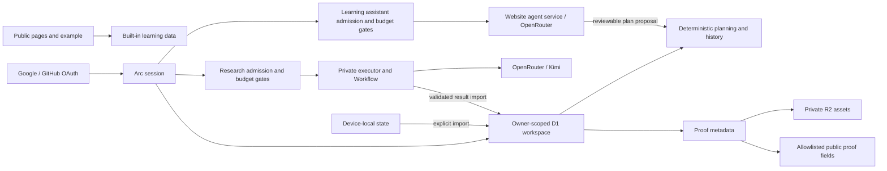

# Arc.

**English** · [简体中文](./README.zh-CN.md)


[](https://github.com/Earorua/arc/actions/workflows/ci.yml)
[](https://arcmaps.net)

**A precision learning system that turns a target role into skills, a practical learning plan, and evidence of progress.**

Arc connects role research, self-assessment, available study time, daily tasks, learning resources, and work samples. A learning companion answers questions in the context of the active plan; a planning assistant proposes changes for the learner to review.

[Visit Arc](https://arcmaps.net) · [Explore the public example](https://arcmaps.net/showcase) · [Set up a learning plan](https://arcmaps.net/setup) · [Release records](./docs/operations/README.md)

## Current source and release — 2026-10-29

Arc v8 runs on the owner's Cloudflare Workers, D1, private R2, and Workflows at **[arcmaps.net](https://arcmaps.net)**. Google and GitHub provide independent Arc sign-in. The previous ChatGPT Sites address redirects to this domain; it is no longer the application host.

This source combines custom-role Research, the learning companion and planner, the Discovery-inspired visual theme, the complete learning-workspace redesign, and the **29 October 2026** Research and navigation fixes. The latest deployment recorded in this tree uses application commit `a826114` and Site version `bd827c05-4041-40e3-90cd-b97127fc1f6b`; the private Research executor remains at `60b176c2-be13-4df2-8743-c899b596f6d4`. The [latest release verification](./docs/verification/2026-10-29-home-method-entry.md) preserves its scope and evidence. GitHub source updates and application deployments are separate operations.

This release includes four-step setup with draft recovery, an explicit **uncertain** skill assessment, context-preserving navigation between tasks, skills and evidence, history progress, responsive learning resources, and consistent first rendering when an existing session is restored.

The homepage now has one state-aware learning action: create a plan, resume a draft, or continue an existing route. Repeated learning, example, and method links have been reduced while preserving task-specific navigation. Research accepts safe fallback titles for blank citation labels, and diagnostics use the same bounded JSON-code-fence handling as import; source and quality checks still apply. This source also retains Proof draft restoration, basic-plan continuity fixes, and bounded recovery from transient Windows errors in local smoke-test nonce storage.

## The learning loop

| Area | What it does |
| --- | --- |
| **Setup** | Choose a role, assess skills, set study time, and confirm the plan. Signed-in users can explicitly start custom-role Research. Safe steps and account-scoped drafts survive refresh and back navigation. |
| **Path** | Follow dependency-ordered learning units, inspect current and completed tasks, edit availability, and review a full proposed-plan diff before accepting it. |
| **Today** | Work through one scheduled task with its saved resources, record completion, and continue to the relevant skill or work evidence. Checking a step alone does not save task completion. |
| **Stack** | Browse skills, prerequisites, mastery criteria, resources, and evidence. Search, filters, expanded skills, and return context are preserved across evidence navigation. |
| **Proof** | Keep versioned work evidence and private attachments, inspect review outcomes, and selectively publish chosen fields. |
| **History** | Read preserved plans and their available completion counts. Historical plans are read-only; restoring one as the current plan is not implemented. |
| **Learning help / Coach** | Ask about the current task or request a plan adjustment. Suggestions fill a draft; sending a model request and accepting a plan change are explicit actions. |

The built-in AI full-stack engineer catalogue contains **16 skills and 48 unit templates** for learning, calibration, and reinforcement. Actual route length depends on self-assessment and scheduling. Accepted Research supplies a validated role blueprint and unit registry to the same deterministic planning system. Source policy prioritizes official courses from leading US universities and US companies, followed by leading Chinese companies, and supports both free and paid resources.

An **uncertain** self-assessment schedules calibration while retaining the learning content. Completing calibration does not declare mastery or skip the remaining learning. Self-assessment, curated claim confidence, task completion, and Proof review status have separate meanings.

Creating another goal from an existing adaptive plan currently requires signed-in Research; it preserves the old plan in history. When that service is unavailable, Arc explains the limit and keeps the existing plan intact.

## Public experience and personal workspace

The home page, method, and **[public example](https://arcmaps.net/showcase)** are available without an account. The example uses clearly identified sample content. Setup retains a device-local deterministic path. Personal learning data and workspace actions require sign-in; Coach can show its public introduction before authentication.

After sign-in, D1 is authoritative for learning state. Existing device-local work is offered as an explicit import choice; Arc does not silently replace or delete it. Account changes and expired sessions preserve ownership boundaries rather than displaying another learner's state or substituting sample progress.

## Research and learning assistants

**Role Research** runs through a private service-bound Cloudflare executor and durable Workflow using OpenRouter/Kimi. It supports status recovery, validated result import, replay protection, and idempotent accounting. A result becomes usable only after structure and source-evidence checks pass. Reading the built-in `GET /api/intelligence/flagship` endpoint is public, read-only, and independent of model access.

**The learning companion and planner** run through the website's separate server-side agent service. They use the active goal, actual progress, current due task, and saved resources; invalid Research context produces a recovery state instead of a silent fallback to the Flagship route. Planning suggestions require review before application. Planner generation is not a durable background job when the page is closed.

Research and assistants have separate credentials and budget controls. The [companion release record](./docs/operations/learning-companion-release-2026-10-28.md) documents the enabled configuration and its verification limits. The latest navigation release did not repeat live OAuth, paid Research or assistant calls, production uploads, or administrator-data acceptance. The Research response repair was verified with synthetic tests, build checks, and deployment readback; it does not guarantee that every future model result will pass validation.

## Design

The current Discovery-inspired theme uses warm paper surfaces, charcoal text, purple accents, Fraunces and Noto Serif SC display type, and Jost interface text. Shared navigation keeps Today, Path, Stack, and Proof prominent, with history and planning tools available from the relevant task context.

Mobile layouts, visible keyboard focus, readable control sizes, browser zoom, and system or personal reduced-motion preferences are covered by the recorded UI checks. Those checks have explicit coverage limits and are not a claim of full accessibility certification.

## Architecture



| Layer | Technology and responsibility |
| --- | --- |
| UI | React 19, Next-compatible App Router, shared learning components, Motion, and CSS themes |
| Runtime | Vinext, Vite 8, and Cloudflare Workers for server rendering and APIs |
| Identity | Better Auth with Google and GitHub; server-derived Arc sessions |
| Durable state | Cloudflare D1 and Drizzle migrations for learning, history, evidence, accounting, and operations |
| Private storage | Cloudflare R2 for owner-scoped assets and private result receipts |
| Planning | Versioned contracts, validated registries, deterministic scheduling, event replay, and proposed-plan diffs |
| Research | Private executor, Cloudflare Workflows, authenticated bridge messages, and validated OpenRouter results |
| Assistants | Server-side planner and tutor with current-workspace context and separate reservations |
| Quality | Vitest, Testing Library, TypeScript, ESLint, rendered-HTML checks, and isolated browser acceptance |
| Delivery | GitHub review and CI, followed by a separately controlled Cloudflare deployment |

## Trust and operating boundaries

- Private requests derive the owner from the Arc session. The browser cannot choose a user ID or private storage key.
- R2 bytes remain private. Public Proof views expose only selected fields; share tokens are hashed at rest and revocable.
- Setup evidence is self-reported metadata. Proof's `verified` state requires a supported deterministic validator; completing a learning task alone does not grant it.
- OAuth, session, bridge, and model secrets stay on the server. This repository excludes real credentials, live databases, private backups, and raw operational logs.
- Research and learning assistants enforce their respective enablement, access, rate, and budget checks before provider access. Application reservations are not provider invoices; a rejected or interrupted request can still incur provider cost.
- The initial Research release records a USD 5 cumulative provider-key cap and USD 3.50 request reservation. Assistant limits are documented separately. These are release-time settings, not a statement of current remaining credit; available budget can block a request.
- `/admin` is read-only, exact-email allowlisted, and aggregate-only.
- GitHub CI does not deploy the application. Production changes require a separate release with current configuration and data checks. Never replay consumed release scripts or restore an old backup over newer public writes.
- Before rollback, check compatibility with saved `uncertain` assessments and current history data. Closing Research requires stopping intake, draining outstanding work, then stopping maintenance; the closed smoke environment is separate from production.

## Local development

Use **Node.js 24.14.1**, matching CI and the verified runtime; `package.json` requires Node.js `>=24.14.1`. From a checkout of this source branch:

```bash
npm ci
npm run dev
```

Open the address printed by the development server, normally `http://localhost:3000`. The default [Cloudflare target](./cloudflare.local.json) uses local D1/R2 bindings; leave `ARC_CLOUDFLARE_TARGET` unset for this mode. Starting the development server does not deploy to Cloudflare.

For server configuration, start with [`.env.example`](./.env.example):

```bash
cp .env.example .dev.vars
```

The copy command also works in PowerShell. `.dev.vars*` and local `.env*` files are ignored by Git; `.env.example` contains placeholders only. Research and learning assistants default to disabled with zero budgets. Public example pages and synthetic unit tests require no paid model calls. OAuth-backed workspaces need callback URLs, server secrets, and an initialized local schema; merely copying the example does not provision these services. See [auth setup notes](./docs/operations/cloudflare-shadow-auth-setup.md) and [agent integration](./docs/operations/dual-learning-agents.md) for service-specific configuration.

To inspect a local production build:

```bash
npm run build
npm run start
```

## Repository layout

| Path | Contents |
| --- | --- |
| [`app/`](./app/) | Pages, shared UI, typed contracts, planning domain, API routes, and server services |
| [`db/`](./db/) / [`drizzle/`](./drizzle/) | Database schema and ordered migrations; `npm run db:generate` generates migrations, it does not apply them |
| [`worker/`](./worker/) | Website entry, Research executor, and isolated smoke environment |
| [`build/`](./build/) / [`scripts/`](./scripts/) | Cloudflare target validation, builds, checks, and operational tools |
| [`tests/`](./tests/) | Unit, integration, rendered-HTML, and browser-preview fixtures |
| [`docs/operations/`](./docs/operations/README.md) | Release records, configuration, recovery notes, and retained history |
| [`docs/verification/`](./docs/verification/) | Scoped verification and deployment records |

Historical documents may reference ignored `outputs/` evidence retained only in the original workspace. Real secrets, databases, private backups, dependencies, and build artifacts are excluded from the source repository.

## Verification

```bash
npm run test:unit
npm run lint
npx tsc --noEmit
npm run build
node --test tests/rendered-html.test.mjs
```

`npm test` combines the production build and rendered-HTML tests; run `npm run test:unit` separately for the unit suite. On resource-limited machines, cap Vitest concurrency without changing test limits:

```bash
node node_modules/vitest/vitest.mjs run --maxWorkers=4
```

CI runs unit tests, lint, the production build, and rendered-HTML checks on pull requests and pushes to `master`. The badge above reports `master`. TypeScript is also checked locally. Browser acceptance instructions are in [`tests/ui-preview/README.md`](./tests/ui-preview/README.md); its isolated tooling is separate from `npm ci`, and synthetic scenarios do not establish production account or model behavior.

The [source verification record](./docs/verification/2026-10-29-source-readme.md) contains this update's actual results. The earlier Windows backend-smoke failure and its subsequent fix are retained in the [persistence repair record](./docs/operations/smoke-nonce-persistence-fix-2026-10-29.md). Historical test counts are not substituted for the current CI result.

## Release references and next work

- [Latest recorded homepage release](./docs/verification/2026-10-29-home-method-entry.md)
- [Workspace navigation simplification](./docs/verification/2026-10-29-workspace-control-simplification.md)
- [Research response repair](./docs/operations/research-response-recovery-2026-10-29.md)
- [Workspace redesign and recovery constraints](./docs/operations/experience-redesign-release-2026-10-28.md)
- [Learning companion activation and configuration](./docs/operations/learning-companion-release-2026-10-28.md)
- [Implemented experience changes and acceptance](./docs/superpowers/plans/2026-10-28-experience-completion-delivery.md)
- [Current checkpoint and retained history](./docs/operations/v8-resume-checkpoint.md)

The first public-release objective is complete. Durable background planning, restoring historical plans as current, further learner feedback, and future usage-budget decisions remain separate follow-up work.
