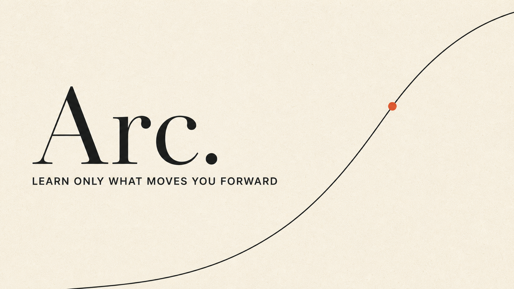
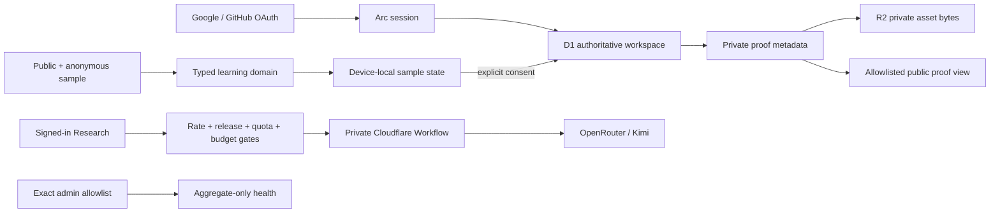

# Arc.



[](https://github.com/Earorua/arc/actions/workflows/ci.yml)
[](https://arcmaps.net)

**A precision learning system for mastering the technology stack behind a target role.**

Arc. turns a career goal into an attributable skill map, a schedule-aware path, one focused learning session at a time, and an honest picture of capability. It is built as a product—not a course catalog—to demonstrate how restrained design, credible state modeling, and explicit trust boundaries can make a complex journey feel clear.

[Visit Arc](https://arcmaps.net) · [Start Research](https://arcmaps.net/setup) · [Current recovery checkpoint](./docs/operations/v8-resume-checkpoint.md)

## Current release — 2026-10-27

Arc v8 is publicly available in the owner's Cloudflare account. The application, D1 database, private R2 files and background Research workflow run independently of ChatGPT Sites. Google and GitHub provide Arc sign-in; Research uses OpenRouter and Kimi. The previous Sites project remains only as an old-link redirect. Use **https://arcmaps.net** for bookmarks and sharing; the WWW address redirects to the same canonical domain.

Signed-in users can enter a custom role on Setup and select **Research this role**. Course sources prioritize official offerings from leading US universities and US companies, followed by leading Chinese companies; free and paid courses are supported. Selecting Continue is separate from starting Research.

## The product loop

Arc. organizes the learning journey into five connected decisions:

1. **Setup** — choose the role, assess each Flagship skill, record optional evidence metadata, set availability, and choose an honest scope.
2. **Path** — follow a dependency-ordered route with explicit calibration and deferred-skill rationale.
3. **Today** — complete one focused deliverable inside a rolling seven-day plan and review any proposed replan.
4. **Stack** — inspect skills, curated claim confidence, sources, freshness, and prerequisites.
5. **Proof** — turn completed work into private evidence and selectively publish only chosen fields.

The flagship experience maps 16 skills for an AI full-stack engineer. Accepted custom-role Research can also supply the v8 adaptive skill audit and learning plan. Research output must pass structure and source-evidence validation before it is published. The original learning plan and later Research plans remain accessible through history.

## Planning foundation

Phase 1 adds a canonical, versioned intelligence contract for the built-in Flagship role. Each learning resource carries its language, cost, format, source tier, and last verification date, and Stack renders that evidence alongside prerequisites and mastery criteria. Stack's confidence value is confidence in the curated role claim; it is not a score of the learner's mastery, readiness, Proof status, or verification.

The candidate's `GET /api/intelligence/flagship` endpoint is public, read-only, and guest-safe. It serves only the schema- and policy-validated built-in Flagship blueprint, without reading a session or user identifier. The Stack page consumes the same deterministic built-in source directly, so the guest path has no network or model dependency.

The planning foundation adds strict contracts, a curated 48-unit Flagship Registry, deterministic path and calendar primitives, a rolling seven-day scheduler, event-sourced replanning with full diffs, guarded guest storage, owner-scoped D1 persistence and APIs, resumable device import, and adaptive Setup, Path, and Today surfaces. Accepted Research supplies a validated custom-role planning package to the same scheduling flow.

Historical Phase 2 engineering evidence at commit `19b8c87` remains in the operations records. Current release acceptance is recorded at r206: real Research and source quality, fault recovery and replay, final-domain authentication, history preservation, and actual proposal/discard persistence across reload. The overdue-unit planning fix passed focused regressions, related tests, typecheck and build; this source backup does not claim another full test run.

Skill levels are learner self-assessment. Optional evidence is learner-supplied public-link metadata only: Arc. does not fetch, review, upload, demonstrate, or verify it, and Phase 2 does not modify Proof state or grant `verified` status.

Production schema and data migration have been verified in the owner's D1 database. Deterministic Flagship reads do not call a model; starting real Research is an explicit signed-in action. Today checkboxes are local interaction state: checking a box alone is not a persisted completion event.

## Two honest modes

**Anonymous sample.** Anyone can explore the public story and complete the deterministic flagship path without an account. This mode stays device-local and remains useful when identity, cloud storage, or AI is unavailable.

**Independent Arc. account.** The codebase supports Google and GitHub OAuth owned by Arc.—not ChatGPT identity. After sign-in, D1 is authoritative for learning state. Meaningful work already present on the device is shown as an explicit import choice; it is never silently moved, overwritten, or deleted.

Google and GitHub sign-in on the final domain were both verified against the migrated owner account. Old and new learning histories are retained. Authentication and ownership checks remain mandatory for private state. The release record distinguishes live checks from automated isolation tests; it does not claim a separate non-owner live login where none was performed.

## Design thesis: Warm Precision

Arc. borrows the confidence of editorial publishing rather than the density of a traditional dashboard. Ivory paper, charcoal type, vermilion signals, Newsreader display typography, and restrained motion create a calm hierarchy around the next meaningful action.

The visual system is intentionally image-light. Structure, type, spacing, and language carry the product personality, while keyboard navigation, visible focus, reduced-motion behavior, mobile workspace controls, and actionable recovery states remain part of the core experience.

## Architecture



| Layer | Current choice | Responsibility |
| --- | --- | --- |
| Product UI | React 19, Next-compatible App Router | Public story, account experience, learning workspace, recovery, and read-only operations |
| Runtime | Vinext, Vite 8, Cloudflare-compatible worker | Edge-compatible server rendering, APIs, and response safety headers |
| Identity | Better Auth with Google and GitHub adapters | Independent Arc. sessions; credentials remain server-only |
| Durable state | Cloudflare D1 with Drizzle migrations | Signed-in goals, events, proofs, idempotency, quota ledger, and sanitized operations |
| Private files | Cloudflare R2 | Owner-scoped proof bytes; D1 stores searchable ownership metadata |
| Anonymous state | Guarded browser storage | Device-local sample, explicit migration source, and capped offline mutation queue |
| Intelligence | Versioned Flagship contract + background Research | No-network Flagship reads and validated custom-role results from OpenRouter/Kimi |
| Adaptive planning | Versioned Registry + deterministic event-sourced kernel | Flagship and accepted Research audit, path, seven-day plan, diff review, replay and persistence |
| Controls | D1 rate limits and cohort flag + runtime limits | Per-user quota, global budget, release cohort, and emergency kill switch |
| Quality | Vitest, Testing Library, TypeScript, ESLint, rendered HTML checks | Domain behavior, access control, privacy, accessibility, and production confidence |
| Delivery | GitHub source snapshots and owned Cloudflare deployment | Reviewable source, private runtime Secrets, versioned publishing, and controlled recovery |

## Trust boundaries

- Public editorial routes and the anonymous deterministic sample do not require sign-in.
- Signed-in state is accepted only from the server-derived Arc. session; browser requests never select a user ID.
- D1 becomes authoritative after sign-in. Device-local work is imported only after explicit consent and conflict resolution.
- Proof assets are private in R2. Retrieval first proves ownership through D1 and never accepts an object key from the caller.
- A public proof token stores only a SHA-256 hash at rest and exposes only the fields the owner selected. Revocation disables the database record; public routes never serve R2 bytes.
- The browser never receives OAuth secrets, session secrets, or provider credentials. Real values belong only in server-side secret management.
- Live Research is available to signed-in users; deterministic Flagship reads remain independent of model credentials.
- Phase 2 evidence fields are self-reported metadata, not Arc verification. Planning completion never writes legacy Proof verification state.
- Every paid call must pass identity, endpoint rate limiting, the runtime kill switch, the D1 release flag, per-user quota, and the global budget ceiling before a reservation is issued.
- Provider calls may incur costs even if output is rejected. The initial public release keeps a USD 5 cumulative non-resetting provider-key cap, a USD 3.50 per-request reservation, one request per user per day and one per minute, and USD 5 site day/month budgets. Remaining credit may prevent a later reservation. Automatic paid repair is disabled; no automatic recharge or limit increase is authorized.
- Operational diagnostics contain sanitized metadata rather than secret values. Private result receipts and learner records remain in owner-scoped storage.
- `/admin` is read-only, exact-email allowlisted, and aggregate-only; it cannot browse learner content or identity records.

## Hosted Beta status

The live app runs on owned Cloudflare Workers, D1 and private R2, with a private service-bound Research Executor and Workflows. The public domain's Google/GitHub login, learning history and plan proposal/discard persistence have been checked. The separate smoke environment is closed and does not need another control-secret input or repeated simulation.

Exact versions, frozen source hashes and backup references are in the current recovery checkpoint. A release incident requires closing intake, draining existing jobs and then stopping maintenance. Do not run consumed rehearsal scripts or restore an old database backup over newer public writes. A domain reversal alone is not a data rollback.

Older [Sites OAuth feasibility notes](./docs/operations/sites-oauth-feasibility.md) are historical. This public source repository excludes actual credentials, live databases, private backups and raw operational logs.

## Local development

Use Node.js **24.14.1**, matching the verified runtime and current CI configuration.

```bash
npm ci
npm run dev
```

Copy `.env.example` to an ignored local environment file only when exercising server features. Keep credential values out of source control. Deterministic paths and unit tests require no paid model calls; real Research requires securely configured server credentials and available budget.

## Verification

```bash
npm run test:unit
npm run lint
npx tsc --noEmit
npm run build
node --test tests/rendered-html.test.mjs
```

CI runs the unit, lint, production-build, and rendered-HTML gates on pull requests and pushes to `master`.

## Focused roadmap

The first public-release objective is complete. Further user feedback, design improvements, learning-flow extensions and usage-budget decisions are separate follow-up work. Preserve official course-source requirements, account isolation and durable learning state when extending the product.
