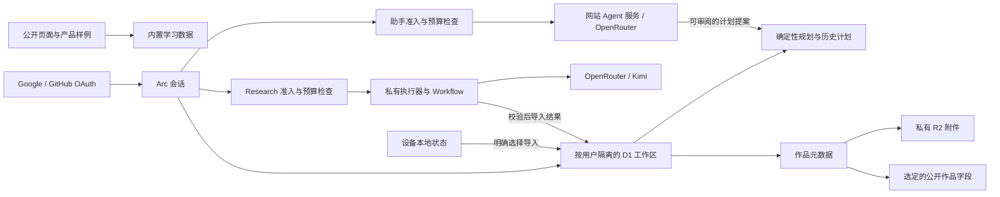

# Arc.

[English](./README.md) · **简体中文**


[](https://github.com/Earorua/arc/actions/workflows/ci.yml)
[](https://arcmaps.net)

**把目标岗位转化为技能图谱、可执行的学习计划和可追溯的进步证据。**

Arc 将岗位研究、技能自评、可用时间、每日任务、学习资料和作品证据连接起来。学习伙伴结合当前计划解答问题，规划师提出调整建议，由学习者审阅后决定是否应用。

[访问网站](https://arcmaps.net) · [查看产品样例](https://arcmaps.net/showcase) · [创建学习计划](https://arcmaps.net/setup) · [发布记录](./docs/operations/README.md)

## 当前源码与发布状态 — 2026-10-29

Arc v8 在自有的 Cloudflare Workers、D1、私有 R2 和 Workflows 上运行，正式域名为 **[arcmaps.net](https://arcmaps.net)**。Google 和 GitHub 提供独立的 Arc 登录；原 ChatGPT Sites 地址现在负责跳转。

本源码包含自定义岗位 Research、学习伙伴与规划师、Discovery 视觉主题、完整学习工作区改版，以及 **2026 年 10 月 29 日**的 Research 和导航修正。源码中最新记录的正式发布使用应用提交 `a826114`，网站版本为 `bd827c05-4041-40e3-90cd-b97127fc1f6b`；私有 Research 执行器仍为 `60b176c2-be13-4df2-8743-c899b596f6d4`。实际范围和证据见[最新发布验收](./docs/verification/2026-10-29-home-method-entry.md)。GitHub 源码更新与网站部署分别进行。

工作区支持四步学习设置、草稿恢复、明确的「不确定」技能自评、任务与技能和证据之间的上下文导航、历史计划进度、响应式学习资料，以及登录状态恢复时的一致首屏。

首页现在统一为一个根据状态变化的学习入口：创建计划、恢复草稿或继续已有路线。重复的学习、样例和方法链接已精简，同时保留与当前任务有关的导航。Research 为引用空标题提供安全占位，诊断与导入采用一致的、有长度限制的 JSON 代码块处理，来源和质量校验继续生效。源码也保留作品草稿恢复、基础学习计划连续性修复，以及本地烟雾测试 nonce 文件保存的 Windows 临时错误恢复。

## 学习流程

| 模块 | 功能 |
| --- | --- |
| **学习设置（Setup）** | 选择岗位、评估技能、安排时间并确认计划。登录用户可主动发起岗位研究；账户范围内的草稿和安全步骤支持刷新与返回恢复。 |
| **学习路径（Path）** | 按依赖关系推进学习单元，查看当前和已完成任务、调整时间，先审阅新旧计划差异再确认变更。 |
| **今日学习（Today）** | 使用已保存的资料完成当前任务，记录完成状态，并转到对应技能或作品证据。仅勾选步骤不会自动保存任务完成。 |
| **技能图谱（Stack）** | 查看技能、先修关系、掌握标准、资料和证据；跨页查看作品时保留搜索、筛选、展开状态与返回上下文。 |
| **作品证据（Proof）** | 保存带版本的作品和私有附件，查看审核结果，并选择需要公开的字段。 |
| **历史计划（History）** | 查看保留的计划及可用的完成统计。历史计划当前只读，恢复为当前计划属于后续工作。 |
| **学习伙伴／规划师（Coach）** | 针对当前任务提问或请求调整计划。建议先填入草稿，发送模型请求和接受计划变更都由用户明确操作。 |

内置 AI 全栈工程师目录包含 **16 项技能和 48 个单元模板**，覆盖学习、校准和巩固。实际路线长度取决于自评和时间安排。通过验收的 Research 为同一套确定性规划系统提供岗位蓝图和单元目录。来源策略优先采用美国知名高校、美国公司的官方课程，其次为中国头部公司的官方课程，并允许免费和付费资料。

选择「不确定」会安排校准，同时保留学习内容。完成校准不会自动认定已经掌握，也不会跳过剩余学习。技能自评、资料主张可信度、任务完成和作品审核状态各有独立含义。

已有自适应计划时，创建另一个目标目前需要登录后进行 Research，旧计划会保留在历史中。服务不可用时，Arc 会说明限制并保留已有计划。

## 公开体验与个人工作区

首页、学习方法和[产品样例](https://arcmaps.net/showcase)无需账号即可访问，样例内容有明确标识。学习设置保留设备本地的确定性路径。个人学习数据和工作区操作需要登录；Coach 在登录前可展示公开介绍。

登录后，以 D1 中的学习状态为准。已有设备本地内容会作为明确的导入选项展示，不会被静默替换或删除。切换账号或会话过期时，继续保持数据所有权隔离，不会显示其他学习者的数据，也不会用样例进度替代真实进度。

## Research 与学习助手

**岗位 Research** 通过私有服务绑定连接 Cloudflare 执行器和持久 Workflow，调用 OpenRouter/Kimi。支持状态找回、结果校验与导入、防重放以及幂等记账。只有通过结构和来源证据校验的结果才可用于学习。内置 `GET /api/intelligence/flagship` 接口仍是公开、只读且不依赖模型调用的接口。

**学习伙伴与规划师** 使用网站独立的服务端 Agent 服务，结合当前目标、真实进度、已到期任务和已保存的资料。Research 上下文无效时显示恢复状态，不会静默退回内置全栈路线。规划建议需审阅后应用；关闭页面后，规划生成不会作为持久后台任务继续运行。

Research 与学习助手分别配置凭据和预算。[学习伙伴发布记录](./docs/operations/learning-companion-release-2026-10-28.md)说明已启用配置和验证范围。最近的导航发布未重新执行真实 OAuth、付费 Research 或助手请求、生产上传和管理员数据验收。Research 响应修正经过合成测试、构建检查和部署回读，但不保证未来每次模型输出都能通过校验。

## 视觉设计

Discovery 风格界面采用暖纸色表面、炭黑文字和紫色强调，标题使用 Fraunces 与 Noto Serif SC，界面文字使用 Jost。共享导航突出今日学习、路径、技能图谱和作品，历史与规划工具从相关任务上下文进入。

移动布局、可见键盘焦点、可读的控件尺寸、浏览器缩放，以及系统或个人减少动效偏好，均纳入已有 UI 检查。检查记录明确列出范围，不等同于完整无障碍认证。

## 技术架构



| 层次 | 技术与职责 |
| --- | --- |
| 界面 | React 19、兼容 Next 的 App Router、共享学习组件、Motion 和 CSS 主题 |
| 运行时 | Vinext、Vite 8 和 Cloudflare Workers，负责页面渲染与 API |
| 身份认证 | Better Auth，支持 Google、GitHub 和由服务端确定的 Arc 会话 |
| 持久数据 | Cloudflare D1 与 Drizzle 迁移，保存学习、历史、证据、记账和运行数据 |
| 私有存储 | Cloudflare R2，保存按用户隔离的附件和私有结果回执 |
| 规划 | 版本化契约、校验后的目录、确定性调度、事件重放和计划差异 |
| Research | 私有执行器、Cloudflare Workflows、认证桥接消息与 OpenRouter 结果校验 |
| 学习助手 | 服务端规划师与答疑伙伴，使用当前工作区上下文和独立额度预留 |
| 质量保障 | Vitest、Testing Library、TypeScript、ESLint、渲染 HTML 检查和隔离的浏览器验收 |
| 交付 | GitHub 审查与 CI，以及单独控制的 Cloudflare 部署 |

## 数据与运行边界

- 私有请求的用户身份来自 Arc 会话，浏览器不能指定用户 ID 或私有对象键。
- R2 附件保持私有。公开作品只展示选定字段；分享令牌以 SHA-256 哈希保存并可撤销。
- 学习设置中的证据为用户自行提供的元数据。作品的 `verified` 状态需要受支持的确定性校验器，完成学习任务不会自动获得该状态。
- OAuth、会话、桥接和模型密钥仅保留在服务端。仓库不包含真实凭据、在线数据库、私有备份和原始运行日志。
- Research 与学习助手分别执行开关、访问、频率和预算检查。应用侧预留与服务商实际账单不同，被拒绝或中断的请求仍可能产生服务商费用。
- 首次 Research 发布记录的服务商密钥累计上限为 5 美元，单次预留为 3.50 美元；助手限额另有记录。这些是发布时配置，不代表当前剩余额度，余额不足可能阻止请求。
- `/admin` 只读，按精确邮箱名单授权，仅展示汇总信息。
- GitHub CI 不会部署网站。生产变更需要独立发布并重新核对当时的配置和数据；不要重复执行已消费的发布脚本，也不要用旧备份覆盖上线后的新写入。
- 回退前需要检查已保存的「不确定」自评与历史数据兼容性。关闭 Research 应先停止接单、等待未完成工作结束，再停止维护；关闭的烟雾测试环境与生产环境相互独立。

## 本地开发

使用与 CI 和已验证运行时一致的 **Node.js 24.14.1**；`package.json` 要求 Node.js `>=24.14.1`。检出本源码分支后运行：

```bash
npm ci
npm run dev
```

打开开发服务器输出的地址，通常为 `http://localhost:3000`。默认 [Cloudflare 目标](./cloudflare.local.json)使用本地 D1/R2 绑定；本地模式下保持 `ARC_CLOUDFLARE_TARGET` 未设置。启动本地开发服务器不会部署到 Cloudflare。

需要服务端配置时，从 [`.env.example`](./.env.example) 开始：

```bash
cp .env.example .dev.vars
```

该复制命令也可在 PowerShell 中使用。Git 忽略 `.dev.vars*` 和本地 `.env*` 文件，`.env.example` 只保存占位配置。Research 和学习助手默认关闭、预算为零。公开样例和使用合成数据的单元测试无需付费模型调用。OAuth 个人工作区还需要回调地址、服务端密钥和已初始化的本地数据库结构；复制示例不会自动配置这些服务。具体配置见[登录配置记录](./docs/operations/cloudflare-shadow-auth-setup.md)和 [Agent 接入说明](./docs/operations/dual-learning-agents.md)。

查看本地生产构建：

```bash
npm run build
npm run start
```

## 目录结构

| 路径 | 内容 |
| --- | --- |
| [`app/`](./app/) | 页面、共享界面、类型契约、规划领域逻辑、API 路由与服务端功能 |
| [`db/`](./db/) / [`drizzle/`](./drizzle/) | 数据库结构与有序迁移；`npm run db:generate` 生成迁移，不会执行迁移 |
| [`worker/`](./worker/) | 网站入口、Research 执行器和独立烟雾测试环境 |
| [`build/`](./build/) / [`scripts/`](./scripts/) | Cloudflare 目标校验、构建、验证与运维工具 |
| [`tests/`](./tests/) | 单元、集成、渲染 HTML 和浏览器预览测试材料 |
| [`docs/operations/`](./docs/operations/README.md) | 发布记录、配置说明、恢复记录和历史资料 |
| [`docs/verification/`](./docs/verification/) | 明确验证范围的验收与部署记录 |

历史文档可能引用仅保留在原工作区、被 Git 忽略的 `outputs/` 证据。真实密钥、数据库、私有备份、依赖目录和构建产物均不纳入源码仓库。

## 验证

```bash
npm run test:unit
npm run lint
npx tsc --noEmit
npm run build
node --test tests/rendered-html.test.mjs
```

`npm test` 包含生产构建与渲染 HTML 检查；单元测试需要单独运行 `npm run test:unit`。资源有限时可限制 Vitest 并发，不改变测试时限：

```bash
node node_modules/vitest/vitest.mjs run --maxWorkers=4
```

CI 在 Pull Request 和推送至 `master` 时运行单元测试、lint、生产构建与渲染 HTML 检查；页首徽章显示 `master` 的状态。TypeScript 也会在本地检查。独立浏览器验收见[预览说明](./tests/ui-preview/README.md)，其工具需要在 `npm ci` 之外单独准备；合成场景不证明生产账号或模型行为。

本次实际结果见[源码验证记录](./docs/verification/2026-10-29-source-readme.md)。此前 Windows 后端烟雾测试的间歇失败及后续修复保留在[持久化修复记录](./docs/operations/smoke-nonce-persistence-fix-2026-10-29.md)中。历史测试数量不替代当前 CI 结果。

## 发布参考与后续工作

- [最近记录的首页发布](./docs/verification/2026-10-29-home-method-entry.md)
- [学习工作区导航精简](./docs/verification/2026-10-29-workspace-control-simplification.md)
- [Research 响应修正](./docs/operations/research-response-recovery-2026-10-29.md)
- [工作区改版与恢复约束](./docs/operations/experience-redesign-release-2026-10-28.md)
- [学习伙伴启用与配置](./docs/operations/learning-companion-release-2026-10-28.md)
- [体验改进与验收明细](./docs/superpowers/plans/2026-10-28-experience-completion-delivery.md)
- [项目检查点与保留的历史记录](./docs/operations/v8-resume-checkpoint.md)

首版公开发布目标已经完成。规划后台持续运行、将历史计划恢复为当前计划、更多学习者反馈改进，以及后续额度决策，属于独立的后续工作。
