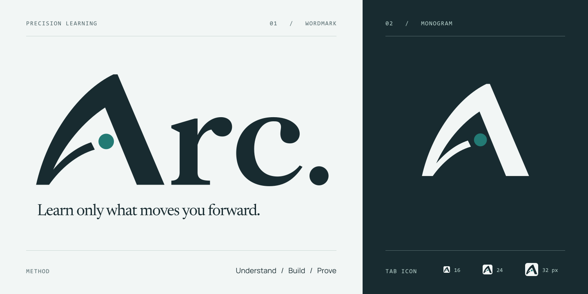

# Arc. brand source

The rising sweep forms the left side of the A. Its dot marks today's position on the learning path. The lettering is the completed November 4 design; the current exports use the released mist, ink and teal palette.

| File | Purpose |
| --- | --- |
| [Wordmark](../../public/brand/arc-logo.svg) and [light wordmark](../../public/brand/arc-logo-light.svg) | Outlined SVG, independent of installed fonts. |
| [Monogram](../../public/brand/arc-mark.svg) and [light monogram](../../public/brand/arc-mark-light.svg) | Transparent square mark. |
| [Wordmark PNG](./arc-logo.png) and [light PNG](./arc-logo-light.png) | Transparent 1296 × 528 exports. |
| [Monogram PNG](./arc-mark.png) and [light PNG](./arc-mark-light.png) | Transparent 512 × 512 exports. |
| [Browser icon](../../public/favicon.svg) | Original geometry adjusted for 16–32 pixels, with current colors. |
| [Identity source](./arc-identity.svg) | Outlined 1440 × 720 composition; [PNG](./arc-identity.png). |
| [Social cover source](./social-cover.svg) | Outlined 1672 × 941 composition; [PNG](../../public/og.png). |

The website and exports share [lettering and palette data](../../app/components/brand/arc-lettering.json). The website inherits its wordmark color and uses the theme's accent token for the dot. Export defaults are ink `#182B30`, mist `#F2F6F5` and teal `#237A74`.

After `npm ci`, run `npm run brand:export`. To verify a clean export outside the checkout, run `npm run test:brand`. The [exporter](../../scripts/export-arc-logo.mjs) accepts `--output-dir <directory>` and resolves all source paths relative to itself.

The exporter retains the original composition and sizes. Newsreader and Manrope come from the existing locked npm font packages. Wawoff2 decompresses their font buffers, Fontkit outlines the text, and Sharp renders the assets; these are build-only dependencies. No browser, screenshot, installed typeface or local absolute path is required. The fixed Consolas caption alphabet is preserved as [editable glyph outlines](./source/caption-glyphs.json), retaining the original captions without requiring that Windows font on the build machine.

The [original November 4 source](./original-20261104/README.md) preserves the prior palette and studio history. It is historical input; use the root exporter for current assets.
